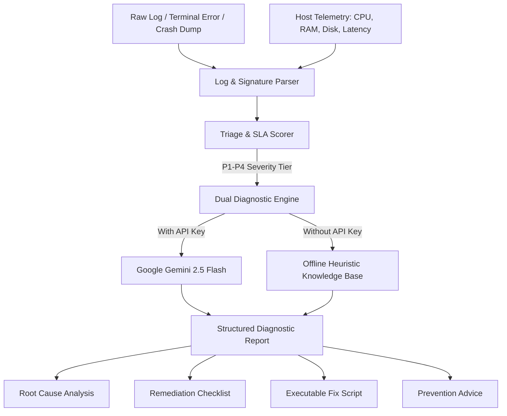

# 🛠️ AutoDesk AI: Automated IT Support & Incident Resolution Agent

[](https://www.python.org/)
[](https://streamlit.io/)
[](https://aistudio.google.com/)
[](https://opensource.org/licenses/MIT)

> **AutoDesk AI** is an intelligent, dual-engine technical support and site reliability agent. It ingests complex system error dumps, stack traces, and hardware vitals, automatically classifies ITIL severity tiers (P1 to P4), diagnoses root causes, and generates actionable recovery scripts.

Developed by **Syed Saqeeb Ali** (*B.Tech CSE - Artificial Intelligence & Machine Learning, Presidency University*).

---

## 🌟 Key Features

* **🩺 Real-Time System Vitals Telemetry:** Live hardware diagnostics assessing CPU load, RAM allocation, disk capacity, active processes, and DNS/network latency via `psutil`.
* **🔍 Error Signature & Stack Trace Parser:** Extracts error codes, line numbers, affected modules, and crash signatures from unformatted terminal logs.
* **🎯 Automated ITIL Triage & SLA Scoring:** Automatically scores incoming issues from **P1 (Critical Outage)** down to **P4 (Low Impact)**, routing each ticket to the responsible engineering team with target resolution SLAs.
* **🧠 Dual Diagnostic Engine:**
  * **Online Mode:** Deep root-cause reasoning powered by **Google Gemini 2.5 Flash**.
  * **Offline Mode:** Built-in heuristic expert system that diagnoses database locks, memory starvation (OOM), runtime exceptions, and socket timeouts without an internet connection or API key.
* **⚡ Executable Fix Generation:** Produces instant copy-paste PowerShell and Bash commands to remediate issues on the spot.
* **💻 Dual User Interfaces:** Ships with both an interactive **Rich Terminal CLI** and a modern **Streamlit Web Dashboard**.

---

## 🏗️ Architecture



---

## 🚀 Quickstart Guide

### 1. Clone the Repository
```bash
git clone https://github.com/demenking105-lab/autodesk-ai.git
cd autodesk-ai
```

### 2. Install Dependencies
```bash
python -m pip install -r requirements.txt
```

### 3. (Optional) Configure Gemini API Key
To use Google Gemini 2.5 Flash for cloud analysis:
```bash
# Windows PowerShell
$env:GEMINI_API_KEY="your_api_key_here"

# Linux / Mac
export GEMINI_API_KEY="your_api_key_here"
```
*(If no API key is provided, AutoDesk AI will automatically run in high-accuracy offline mode).*

---

## 🖥️ Usage

### Option A: Interactive Terminal CLI
Launch the terminal interface:
```bash
python cli.py
```
**Menu Options:**
1. `1` - 🩺 Run Live System & Network Health Scan
2. `2` - 🔍 Triage & Diagnose a Log File (includes built-in sample logs)
3. `3` - ✍️ Paste an Error Traceback for Instant Fix
4. `4` - 🌐 Launch Web Dashboard

### Option B: Streamlit Web Dashboard
Launch the web interface:
```bash
streamlit run app.py
```
Open `http://localhost:8501` in your browser.

---

## 📂 Repository Structure

```
autodesk-ai/
├── README.md               # Project documentation & setup guide
├── requirements.txt        # Python package dependencies
├── .env.example            # Environment configuration template
├── cli.py                  # Interactive rich-terminal CLI
├── app.py                  # Streamlit web dashboard
├── sample_logs/            # Test datasets for demonstration
│   ├── memory_leak.log     # Out-of-memory (OOM) crash sample
│   ├── database_timeout.log# Database pool exhaustion sample
│   └── python_crash.log    # Unhandled runtime exception sample
└── core/
    ├── __init__.py
    ├── system_scanner.py   # Live hardware & network telemetry
    ├── log_parser.py       # Regex pattern & traceback extractor
    ├── triage_engine.py    # Priority scoring (P1-P4) & SLA calculator
    └── ai_resolver.py      # Dual-mode AI diagnostic & script engine
```

---

## 📊 Sample Output (Memory Leak Triage)

```
╔══════════════════════════════════════════════════════════════════╗
║ SEVERITY TIER: P1 - CRITICAL                                     ║
║ Assigned Team: DevOps & Infrastructure                           ║
║ Target SLA: 30 mins                                              ║
╚══════════════════════════════════════════════════════════════════╝

Root Cause Assessment:
Process terminated due to memory starvation (OOM). A memory leak or runaway worker 
consumed available virtual memory/swap.

Immediate Remediation Checklist:
  1. Identify and terminate the high-memory consuming PID.
  2. Inspect recent data payload sizes or infinite recursion in active jobs.
  3. Increase container/VM memory limits or enable swap allocation temporarily.

Automated Fix Commands:
  Get-Process | Sort-Object WorkingSet -Descending | Select-Object -First 5
  taskkill /PID <TARGET_PID> /F
```

---

## 👤 Author
* **Syed Saqeeb Ali**
* **Institution:** Presidency University, Bengaluru
* **Major:** B.Tech CSE (Artificial Intelligence & Machine Learning)
* **GitHub:** [@demenking105-lab](https://github.com/demenking105-lab)
* **Email:** [demenking.105@gmail.com](mailto:demenking.105@gmail.com)

---

## 📄 License
This project is licensed under the MIT License - see the LICENSE file for details.
